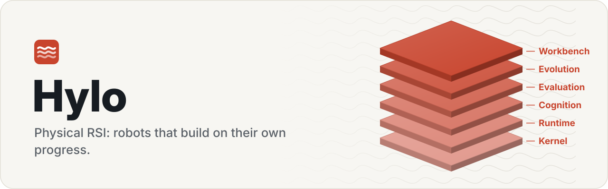
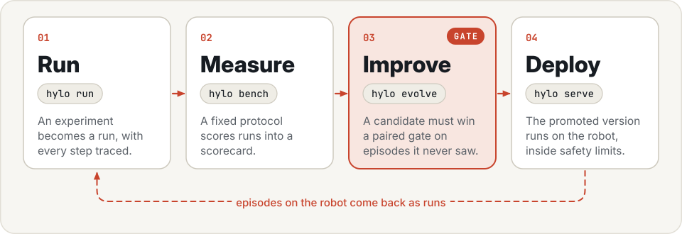
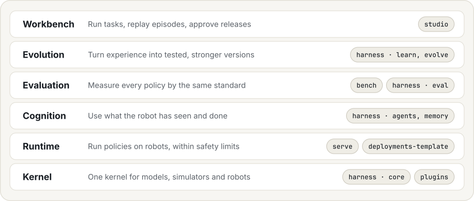

<p align="center">
  <picture>
    <source media="(prefers-color-scheme: dark)" srcset="assets/banner-dark.svg">
    
  </picture>
</p>

<p align="center">
  <a href="https://hyloai.github.io/"><b>Website</b></a> ·
  <a href="https://hyloai.github.io/hylo-docs/"><b>Docs</b></a> ·
  <a href="https://hyloai.github.io/hylo-docs/getting-started/quickstart/"><b>Quickstart</b></a>
</p>

Robots can act on their own, yet people still drive every turn of their improvement: collecting runs, reading
failures, choosing changes, evaluating them and deciding what ships. **Hylo** hands that loop to the system. It
builds worlds, runs tasks, improves, verifies every change against physical outcomes and deploys what passes, and
each round starts from what the last one adopted. People set the goals and approve what reaches hardware.

[Physical RSI](https://hyloai.github.io/hylo-docs/physical-rsi/) ·
[Robot worlds](https://hyloai.github.io/hylo-docs/user-guide/worlds/) ·
[Tool-calling agents](https://hyloai.github.io/hylo-docs/user-guide/tool-agents/) ·
[Campaigns](https://hyloai.github.io/hylo-docs/user-guide/campaigns/) ·
[Robot skills](https://hyloai.github.io/hylo-docs/user-guide/skills/) ·
[Run an existing policy](https://hyloai.github.io/hylo-docs/getting-started/quickstart/)

<p align="center">
  <picture>
    <source media="(prefers-color-scheme: dark)" srcset="assets/loop-dark.svg">
    
  </picture>
</p>

### The Hylo stack

Six layers on one execution kernel. Together they turn the loop.

<p align="center">
  <picture>
    <source media="(prefers-color-scheme: dark)" srcset="assets/stack-dark.svg">
    
  </picture>
</p>

| Layer | | Repository |
|---|---|---|
| **Workbench** | Watch and steer the loop: worlds, runs, campaigns and workcells in one place. | [hylo-studio](https://github.com/HyloAI/hylo-studio) |
| **Evolution** | Improve through training, memory, programs and skills, and keep only what passes the gate. | [hylo-harness](https://github.com/HyloAI/hylo-harness) (learn, evolve) |
| **Evaluation** | Verify every change against physical outcomes, on cases it was not built on. | [hylo-bench](https://github.com/HyloAI/hylo-bench), [hylo-harness](https://github.com/HyloAI/hylo-harness) (eval) |
| **Cognition** | Drive the robot with a general model and tools, a planner with an action model, or an action model alone. | [hylo-harness](https://github.com/HyloAI/hylo-harness) (manip, agents, policies, memory) |
| **Runtime** | Serve models and run approved versions on robots, within configured safety limits. | [hylo-serve](https://github.com/HyloAI/hylo-serve), [hylo-deployments-template](https://github.com/HyloAI/hylo-deployments-template) |
| **Kernel** | One execution kernel connects models, simulators and robots. | [hylo-harness](https://github.com/HyloAI/hylo-harness) (core), [hylo-plugins](https://github.com/HyloAI/hylo-plugins) |

Documentation: [hylo-docs](https://github.com/HyloAI/hylo-docs)

### Quick start

```bash
git clone https://github.com/HyloAI/hylo-harness.git harness
HYLO_GIT_BASE=https://github.com/HyloAI harness/dev/bootstrap.sh
uv run hylo run bench/examples/configs/mujoco_reach.yaml
```

Hylo AI, open source under the Apache License 2.0.
